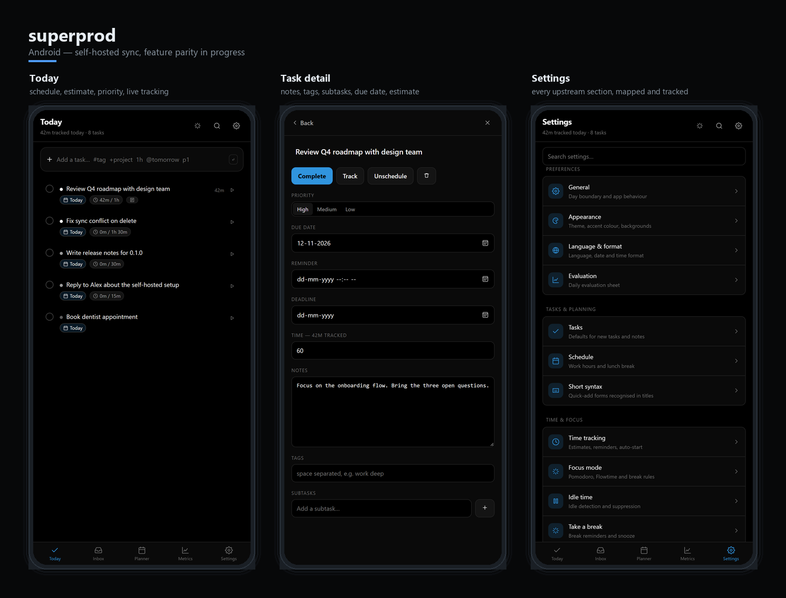

# superprod

> A fresh Android client for **Super Productivity** — same data, same self-hosted sync,
> full feature parity, new UI.

superprod is an independent client for the [Super Productivity](https://super-productivity.com)
platform. It connects to your Super Productivity data through **SuperSync** (hosted or
self-hosted) and aims to expose every feature the official clients expose, in a UI built
for phones first.

It is **not** a fork, not a rewrite of the platform, and not a new backend. The server,
the wire protocol and the data model stay Super Productivity's; superprod is a new way to
read and write that data.

## What it is / what it isn't

| | |
|---|---|
| **Is** | An Android app (plus a web build from the same code) that syncs with SuperSync |
| **Is** | Feature-parity targeted: nothing is cut for simplicity — see `PARITY.md` |
| **Is** | Self-hosted first: point it at your own server, no account required beyond that |
| **Isn't** | A replacement for Super Productivity, or an alternative to its server |
| **Isn't** | A fork — no upstream code is vendored into the app |
| **Isn't** | A SaaS: no analytics, no telemetry, no cloud dependency |

## Project identity

| Field | Value |
|---|---|
| App name | `superprod` (all lowercase) |
| Package ID | `com.dwprod.superprod` |
| Stack | TypeScript · Vite · SolidJS · Capacitor (Android) |
| Primary target | Android |
| Secondary target | Web (same codebase, installable PWA) |
| Sync | SuperSync — any compatible server, hosted or self-hosted |
| Goal | 100% feature parity with Super Productivity |

## Feature parity

`FEATURES.md` is the exhaustive inventory of what Super Productivity does.
`PARITY.md` tracks each item against this client, and `PARITY_MET.md` is the
generated scorecard:

```bash
pnpm parity:metrics
```

Every feature marked **Done** in `PARITY.md` names what was built and how it maps
to upstream. Features that do not exist upstream are explicitly recorded as `N/A`
rather than quietly invented.

## Screenshots



Rendered from the actual app at a phone viewport (`docs/screenshots/`, composed by
`tools/make-mockup.py`).

## Repository layout

```
.
├── README.md              # This file
├── FEATURES.md            # Feature inventory of the platform (parity target)
├── PARITY.md              # Per-feature status tracker
├── PARITY_MET.md          # Generated parity scorecard
├── AGENTS.md              # Contributor/agent guidance, sync invariants
├── FRAMEWORK_OPTIONS.md   # Stack options and the decision taken
├── src/
│   ├── core/              # entity types, operations, vector clocks, op log
│   ├── domain/            # task/project/tag models, config, short syntax
│   ├── sync/              # SuperSync client, sync engine, auth
│   ├── services/          # notifications, reminders, theme
│   ├── state/             # reactive stores
│   └── ui/                # SolidJS screens and design system
├── public/                # notification service worker
├── tests/                 # unit tests
└── original source code/  # Upstream snapshot — gitignored, read-only reference
```

`original source code/` is the upstream Super Productivity tree, kept locally as
read-only reference for behaviour, data models, the sync protocol and the server
API. It is gitignored — the repository stays free of it. Do not edit it, and do not
port its UI.

## Development

```bash
pnpm install
pnpm dev         # dev server
pnpm test        # unit tests
pnpm typecheck   # tsc --noEmit
pnpm build       # production build
```

QA deep links: `?demo=1` (seed demo data), `?view=inbox`, `?open=first`,
`?debug=1` (layout-overflow overlay).

## Sync compatibility

superprod speaks SuperSync, the operation-based protocol used by Super Productivity.
Nothing proprietary is added: a stock SuperSync server serves both clients.

- Per-user, strictly increasing `server_seq` for ordering
- Vector clocks for causality (`MAX_VECTOR_CLOCK_SIZE = 20`)
- Atomic operations: `CRT`, `UPD`, `DEL`, `MOV`, `BATCH`, plus `SYNC_IMPORT`,
  `BACKUP_IMPORT`, `REPAIR` for full-state transfers
- Download of operations since a known sequence, with cursor paging
- Full-state snapshots for initial sync and recovery
- JWT bearer auth; the server issues tokens via magic link or passkey
- End-to-end encryption (Argon2id + AES-256-GCM) — planned, not yet implemented here

Implemented in `src/sync/`: operations upload/download, status, device list,
restore points, restore-at-sequence, snapshot upload, and magic-link login.

### Serving the web build needs CORS on the server

SuperSync only allows the origins listed in `CORS_ORIGINS`, and its default is
`https://app.super-productivity.com` alone. A browser build on any other origin
therefore fails with a bare "Failed to fetch". Set the variable on the server
(comma-separated) and restart it:

```bash
CORS_ORIGINS=https://superprod.example.com,http://localhost:5173
```

The Android app is not affected: it sends sync requests through native HTTP
(`CapacitorHttp`), which is not subject to CORS.

### Debugging

Everything is logged from startup — console output, uncaught errors, unhandled
rejections and every HTTP request — into a bounded in-memory buffer.

**Settings → Debug → Export log** downloads a single text file with the session
log plus environment facts, which is what to attach when reporting a problem.
Preview shows the tail in-app; Copy puts it on the clipboard.

Verify against a real server (read-only — status, devices, restore points and op
download; nothing is written):

```bash
SYNC_BASE_URL=https://sync.example.com SYNC_TOKEN=<jwt> pnpm vitest run tests/sync-live.test.ts
```

## Releases (Android)

`.github/workflows/release-android.yml` builds a **signed** APK + AAB.

**Triggers**
- Push a tag: `git tag v1.2.3 && git push origin v1.2.3`
- Or run the workflow manually with `version: 1.2.3` (optionally unchecking *create release*)

To re-run a release for a tag that already exists, delete and re-push it:

```bash
git tag -d v0.1.0
git push --delete origin v0.1.0
git tag v0.1.0 && git push origin v0.1.0
```

The Android project is generated during the build (`cap add android`) and is
gitignored — there is no committed native tree to drift.

The version flows into `package.json`, `src/app-version.ts` and the Android
`versionName`/`versionCode` (`major*10000 + minor*100 + patch`), so the tag and the
installed app always agree.

**Repository secrets** (Settings → Secrets and variables → Actions)

| Secret | What it is |
|---|---|
| `ANDROID_KEYSTORE_BASE64` | Your release keystore, base64-encoded |
| `ANDROID_KEYSTORE_PASSWORD` | Keystore password |
| `ANDROID_KEY_ALIAS` | Key alias inside the keystore |
| `ANDROID_KEY_PASSWORD` | Password for that key |

Encode the keystore in PowerShell without printing it to the console:

```powershell
[Convert]::ToBase64String([IO.File]::ReadAllBytes("C:\path\to\release.keystore")) | Set-Clipboard
```

The workflow fails fast naming any missing secret, writes `android/keystore.properties`
at mode `600`, and configures signing through `tools/android-release-config.mjs` — no
keystore or password is ever committed.

## License

MIT, matching upstream Super Productivity. "Super Productivity" and its marks belong to
their respective owners; this project is an independent client and is not affiliated with
or endorsed by the Super Productivity maintainers.
